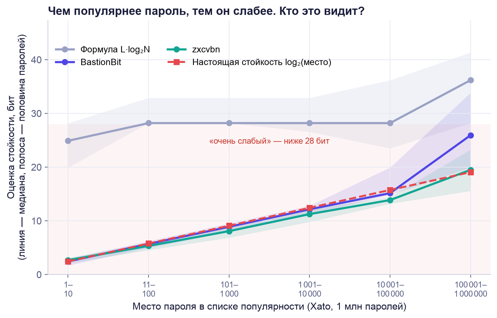
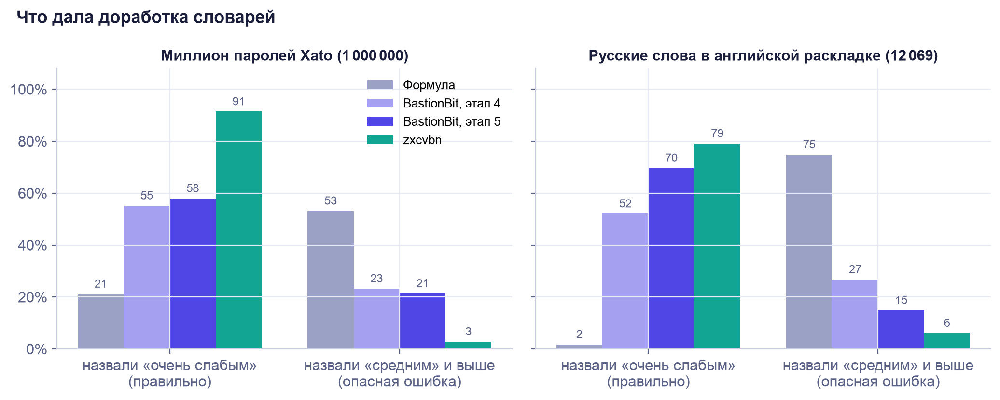

# BastionBit

Генератор надёжных паролей и математический анализ их криптостойкости.
Индивидуальный проект по информатике.

Всё считается в браузере: пароли никуда не отправляются и нигде не сохраняются.
Тренажёр хранит в браузере только соль и хеш, а не сам пароль. Единственный запрос
в сеть — проверка по базе утечек: по кнопке уходят только первые 5 символов хеша SHA-1.

Автор — **Марковицкий Илья Алексеевич**, ученик 10 класса МАОУ «СОШ № 11».

## Что уже умеет

- **Случайный пароль** — длина 8–64, наборы символов, «без похожих символов», точная энтропия.
- **Пароль из ключевого слова** — пароль вычисляется из сайта, версии, ключевого слова
  и мастер-фразы. Его не нужно хранить: те же данные дают тот же пароль на любом устройстве.
- **Русская фраза** — случайная фраза по шаблону с правильной грамматикой:
  «Сливочная уборщица перерисовала 76 позолоченных передников». Показывается и в английской
  раскладке, одной кнопкой становится мастер-фразой. Анализатор узнаёт такие фразы
  и показывает их настоящую стойкость.
- **Правило** — случайное «ментальное правило»: одна основа и метка от названия сайта.
  Показывает пароль для любого сайта, как по шагам получается метка, и **лестницу утечек** —
  сколько бит остаётся взломщику после каждого утёкшего пароля.
- **Анализатор** — оценка по формуле и реальная оценка **детектора хитростей**: он находит
  популярные пароли, частые русские и английские слова, русские имена, фамилии и города (в том числе с заменами `@ → a`,
  задом наперёд, в другой раскладке и транслитом), даты, годы, клавиатурные дорожки,
  повторы и последовательности. Показывает время подбора в трёх ситуациях,
  **срок годности** пароля, поправку на квантовый компьютер и **сравнение с zxcvbn** —
  с графиками.
- **Личные данные** — можно указать имя, дату рождения, кличку питомца и город: детектор
  найдёт их в пароле латиницей, в другой раскладке, задом наперёд, а дату — в 12 видах записи.
- **Проверка утечек** — сверка с базой Pwned Passwords (около 2 млрд паролей из утечек)
  через k-анонимность: сам пароль и даже его полный хеш никуда не уходят.
- **Похожие пароли** — насколько проверяемый пароль похож на другие ваши
  (расстояние Левенштейна) и за сколько попыток его найдёт тот, кто знает старый.
- **Тренажёр** — помогает выучить пароль наизусть: сначала его вводят по памяти 3 раза подряд,
  потом повторяют через 1, 3, 7, 14 и 30 дней. На вкладке видно, сколько паролей пора повторить.
- **«Взломай сам»** — игра из четырёх уровней: популярный пароль, PIN-код, пароль из личных
  данных и случайный пароль. Видно, сколько бит отнимает каждая подсказка и за сколько
  попыток тот же пароль нашла бы программа-взломщик.
- **Теория** — формулы и объяснения простыми словами.
- **Проверка на миллионе паролей** — скрипт `tools/evaluate.js` сравнивает формулу,
  BastionBit и zxcvbn на миллионе настоящих паролей из утечек (результаты — ниже).
- **Анимации** — плавные переходы вкладок, переключателей, кнопок, полей и чисел.
  Работают всегда, даже если в системе включено «Уменьшить движение».
- **Автоматические тесты** — 3 224 проверки в папке `tests`: модули в Node.js и сам сайт
  в браузере на экране компьютера и телефона (см. «Тесты» ниже).

## Как открыть

Дважды щёлкните по `index.html` — сайт откроется в браузере. Сервер не нужен.
Интернет нужен только для проверки по базе утечек.

Словари и библиотеки анализатора весят ≈ 3,2 МБ (около 1 МБ в сжатом виде), поэтому они загружаются, только когда
нужны: на вкладке «Анализатор», в игре «Взломай сам» и когда в тренажёр вводят новый пароль.
Пока они грузятся, оценка считается без них.

Карточки тренажёра хранятся в этом браузере (`localStorage`). В другом браузере
или на другом компьютере их не будет. Если очистить данные сайта, они тоже удалятся.

## Как опубликовать на GitHub Pages

1. Создайте на GitHub новый публичный репозиторий `bastionbit`.
2. Нажмите **Add file → Upload files** и перетащите все файлы из папки `bastionbit`
   (сами файлы и папки `js`, `data`, `vendor`, `assets`, `tools` и `tests`, а не папку целиком).
   Папки `tests/node_modules` и `tests/shots`, если они появились после запуска тестов,
   загружать не нужно. Нажмите **Commit changes**.
3. Откройте **Settings → Pages**. В блоке **Build and deployment** выберите
   **Deploy from a branch**, ветку `main` и папку `/ (root)`, нажмите **Save**.
4. Через 1–2 минуты сайт будет доступен по адресу `https://<ваш-логин>.github.io/bastionbit/`.

## Структура

| Файл | Что внутри |
| --- | --- |
| `index.html` | Разметка: шапка, вкладки, четыре раздела и подвал с автором |
| `style.css` | Оформление. Все цвета — в переменных в начале файла |
| `assets/logo.svg` | Логотип и иконка вкладки браузера |
| `assets/claude.png`, `assets/gemini.png` | Значки Claude и Gemini в подвале |
| `js/random.js` | Криптослучайность без смещения (`crypto.getRandomValues`) и случайность из готовых байтов |
| `js/entropy.js` | Энтропия, время подбора, шкала оценок, форматирование чисел |
| `js/generator.js` | Генератор паролей и точная энтропия (включения-исключения) |
| `js/keyword.js` | Пароль из ключевого слова: PBKDF2, HKDF и оценка стойкости |
| `js/phrase.js` | Русская фраза: шаблон, согласование, стойкость, английская раскладка, узнавание фразы |
| `js/patterns.js` | Детектор хитростей: поиск кусков, их цена в битах, лучшее разбиение, советы |
| `js/rule.js` | Ментальное правило: 3 840 вариантов устройства, пароль для сайта, перебор правил после утечек |
| `js/personal.js` | Личные данные: транслит, другая раскладка, запись задом наперёд, виды записи даты |
| `js/breach.js` | Проверка по Pwned Passwords: SHA-1, k-анонимность, разбор ответа |
| `js/similar.js` | Расстояние Левенштейна, список правок и их цена в битах |
| `js/charts.js` | Графики анализатора на Chart.js: сравнение оценок и срок годности |
| `js/motion.js` | Анимации: появление, перелистывание, бегунки вкладок и переключателей, счётчики, встряхивание поля |
| `js/ui.js` | Общие помощники интерфейса: копирование, кнопка «Показать», подсветка символов, загрузка скриптов |
| `js/app.js` | Вкладки, генератор и анализатор на странице |
| `js/trainer.js` | Тренажёр: расписание повторений, соль и хеш PBKDF2, хранение карточек |
| `js/game.js` | Игра «Взломай сам»: уровни, подсказки, подсчёт оставшихся вариантов |
| `js/trainer-ui.js` | Вкладка «Тренажёр» на странице: карточки паролей и игра |
| `js/rule-ui.js` | Режим «Правило» на странице: шаги правила, метка, лестница утечек |
| `js/extras-ui.js` | Дополнения анализатора: личные данные, проверка утечек, похожие пароли |
| `data/words-ru.js` | Словари для фразы (собраны скриптом, вручную не правятся) |
| `data/top-passwords.js` | 10 000 популярных паролей для детектора (собраны скриптом) |
| `data/dict-ru.js`, `data/dict-en.js` | 47 000 частых русских и 46 000 английских слов (собраны скриптом) |
| `data/dict-names.js` | 57 000 русских имён, фамилий, отчеств и названий мест из OpenCorpora (собраны скриптом) |
| `vendor/zxcvbn.js` | Библиотека zxcvbn 4.4.2 (Dropbox) — оценка для сравнения |
| `vendor/chart.umd.min.js` | Библиотека графиков Chart.js 4.6.1 |
| `vendor/LICENSES.txt` | Лицензии этих библиотек |
| `tools/words/*.txt` | Исходные списки слов по темам |
| `tools/build_words.py` | Проверка слов по OpenCorpora и сборка `data/words-ru.js` |
| `tools/build_dictionaries.py` | Сборка словарей детектора из открытых списков |
| `tools/select_russian.py` | Отбор русских паролей для проверки по словарю Hunspell |
| `tools/evaluate.js` | Проверка формулы, BastionBit и zxcvbn на миллионе паролей |
| `tools/plot_results.py` | Графики по результатам проверки |
| `tools/results/` | Результаты проверки: `evaluation.json`, графики, отобранные русские пароли |
| `tests/run.js` | Запуск всех тестов и сводка по наборам |
| `tests/*-test.js` | Наборы тестов: модули в Node.js и сайт в браузере (Playwright) |
| `tests/reference.py` | Независимая реализация пароля из ключевого слова на Python — для сверки |
| `tests/fixtures/` | Эталоны: формы слов из OpenCorpora и ответы `reference.py` |
| `tests/zxcvbn-lib/` | Внутренние формулы zxcvbn 4.4.2 для сравнения в тестах (лицензия MIT) |
| `tests/package.json` | Команды `npm test` и зависимость браузерных тестов (Playwright) |
| `.gitignore` | Что не попадает в Git: большие исходные списки, зависимости и снимки экрана тестов |

## Формулы

- Энтропия: `H = L · log₂ N` (L — длина, N — размер алфавита).
- Среднее время подбора: `T = 2^H / (2V)` (V — попыток в секунду).
- Точная энтропия генератора: `log₂ |A|`, где `|A| = Σ (−1)^|S| · (N − N_S)^L`.
- Реальная энтропия (детектор): `H = H₁ + H₂ + … + Hₖ + 3 · (k − 1) ≤ L · log₂ N`.
- Срок годности: `t = 2 · (H − 1 − log₂ V₀ − log₂ 86 400)` лет.
- Квантовый перебор (алгоритм Гровера): `H_кв = H / 2`.
- Кривая забывания (Эббингауз): `R = e^(−t/S)` (S — прочность памяти).
- Проверка пароля в тренажёре: `h = PBKDF2-SHA-256(пароль, соль, 600 000)`.
- Цена подсказки в игре: `ΔH = log₂(N_до / N_после)`.
- Стойкость правила после k утечек: `H_k = log₂ M_k` (M_k — сколько разных паролей
  для следующего сайта дают правила, согласные со всеми утечками).
- Личные данные: `H = log₂ K + H_формы + H_регистра` (K — сколько записей о вас указано).
- Расстояние Левенштейна: `D[i][j] = min(D[i−1][j] + 1, D[i][j−1] + 1, D[i−1][j−1] + [aᵢ ≠ bⱼ])`.
- Похожий пароль: `H ≈ d · log₂((2L + 1) · N) − log₂ d!` (d — число правок).
- k-анонимность: `16⁵ = 1 048 576` «корзин» по первым 5 символам хеша, ≈ 2 000 хешей в каждой.

## Пароль из ключевого слова

1. **Нормализация.** Unicode NFC, строчные буквы, `ё` → `е`, лишние пробелы убираются.
   От адреса сайта остаётся только домен: `https://www.VK.com/feed` → `vk.com`.
   Версия — число от 1 до 999.
2. **Ключ.** `K = PBKDF2-SHA-256(фраза ‖ 0x00 ‖ слово, соль, 600 000 повторов)` — 32 байта,
   где соль = `"BastionBit v1" ‖ 0x00 ‖ сайт ‖ 0x00 ‖ версия`.
3. **Пароль.** `HKDF-SHA-256(K, соль "BastionBit v1", info)` даёт поток байтов,
   из которого символы выбираются тем же методом отбора, что и в случайном генераторе.
   В `info` записаны требования сайта (`length=16;sets=lower,upper,digits,symbols;avoid-similar=0`),
   поэтому при других требованиях получается независимый пароль.

Стойкость: `H = min(H_пароля, H_слова + H_фразы)`. Каждое слово из букв даёт не больше
`log₂ 50 000 ≈ 15,6` бита, цифры и символы считаются по `L · log₂ N`.
Время подбора: `T = 2^H / (2 · min(V, V_PBKDF2))`, где `V_PBKDF2 ≈ 1,5·10⁴` попыток в секунду
(одна видеокарта RTX 4090, 600 000 повторов).

**Контрольный пример** — должен совпасть в любом браузере:

- сайт `vk.com`, версия 1;
- ключевое слово `кот`;
- мастер-фраза `фиолетовый ёж продал чайник`;
- требования: 16 символов, все четыре набора, похожие символы разрешены;
- пароль: `|Vq:_o6v^G2Y9\H*`.

## Русская фраза

Шаблон: **какой + кто + что сделал + сколько + [какой] + что**. Каждое место заполняется
равновероятно из своего словаря тем же криптослучайным генератором, число — от 1 до 100.

| Место | Словарь | Бит |
| --- | --- | --- |
| Какой (A) | 622 прилагательных | 9,3 |
| Кто (S) | 645 существительных: звери, птицы, профессии, сказочные персонажи | 9,3 |
| Что сделал (V) | 274 глагола в прошедшем времени | 8,1 |
| Сколько | 100 чисел | 6,6 |
| Какой (A, только в фразе из 6 слов) | 622 прилагательных | 9,3 |
| Что (P) | 1124 предмета | 10,1 |

- 6 слов (по умолчанию): `H = log₂(A · S · V · 100 · A · P) ≈ 52,8` бита.
- 5 слов: `H = log₂(A · S · V · 100 · P) ≈ 43,5` бита.

Взломщик может знать шаблон и словари, поэтому стойкость считается по числу возможных фраз.
Грамматика бит не добавляет: формы слов однозначно зависят от выбранных слов и числа.

**Согласование.** Прилагательное и глагол — в роде того, кто действует
(«синяя кошка нашла», «синее чудище нашло»). Предмет — по числу: 1 чайник, 2 чайника,
5 чайников, 11–14 — как 5. Второе прилагательное: 1 зелёный чайник / зелёную книгу,
2 зелёных чайника, но 2 зелёные книги, 5 зелёных книг.
Буква `ё` пишется как `е`, чтобы фразу было проще набрать.

**Английская раскладка.** Те же клавиши на QWERTY: «синий чайник» → `cbybq xfqybr`.
Пригодится, если сайт не принимает русские буквы.

**Узнавание.** Если мастер-фраза в режиме «Из ключевого слова» или пароль в анализаторе
начинаются с фразы BastionBit (в том числе набранной в английской раскладке), для неё
берётся точная стойкость по словарям, а дописанное после неё считается отдельно.

### Как пересобрать словари

Нужен Python 3 и словарь OpenCorpora для библиотеки pymorphy3:

```
pip install pymorphy3 pymorphy3-dicts-ru
python tools/build_words.py
```

Скрипт проверяет каждое слово по словарю: часть речи, род, одушевлённость, переходность
глагола, все нужные формы. Слова с ошибками и повторы он выводит и в словарь не берёт.
Формы слов взяты из открытого словаря [OpenCorpora](https://opencorpora.org)
(лицензия CC BY-SA 3.0).

## Детектор хитростей

Формула `L · log₂ N` считает каждый символ случайным. Но люди собирают пароли из слов,
дат и клавиатурных дорожек, и взломщик перебирает именно их. Детектор ищет такие куски
и даёт каждому цену — `log₂` числа вариантов, которые взломщику нужно проверить.

| Хитрость | Пример | Цена куска |
| --- | --- | --- |
| Популярный пароль | `qwerty`, `dragon` | `log₂ r`, r — место среди 10 000 популярных паролей |
| Частое слово | `привет`, `monkey` | `log₂ r` среди 47 000 русских или 46 000 английских слов |
| Имя, фамилия, город | `gjyjvfhtdf`, `krasnoyarsk` | `log₂ 56 857 ≈ 15,8` бита — одно из 57 000 имён, фамилий, отчеств и названий мест |
| Замены символов | `p@$$w0rd` | +1 бит за каждый вид замены |
| Другая раскладка, транслит, задом наперёд | `gfhjkm`, `parol`, `drowssap` | +1 бит |
| Заглавные буквы | `Password`, `PASSWORD` | +1 бит; любая смесь — `log₂` числа вариантов |
| Дата | `15051998`, `15.05.98` | `log₂(365 · 81) ≈ 14,9` бита, с разделителем +2 |
| Год | `1998` | `log₂ 81 ≈ 6,3` бита — годы с 1950 по 2030 |
| Клавиатурная дорожка | `qwerty`, `1qaz2wsx`, `йцукен` | старт, длина и повороты — как в zxcvbn |
| Повтор | `aaaa`, `abcabc` | цена куска + `log₂` числа повторов |
| Последовательность | `1234`, `abcd` | `log₂(старт · длина)`, обратная +1 |
| Фраза генератора | «синий еж продал…» | точная стойкость по словарям BastionBit |

Пароль делится на куски так, чтобы сумма была наименьшей (динамическое программирование).
Символы вне хитростей считаются по формуле, но с алфавитом только этих символов.
За каждый стык добавляется 3 бита: взломщик не знает, из каких кусков и в каком порядке
собран пароль. Итог никогда не больше оценки по формуле. Разбираются первые 100 символов,
остальные считаются по формуле.

Чтобы не принимать случайные пароли за хитрые:

- слово из трёх букв стоит не меньше `log₂ 3046 ≈ 11,6` бита — столько таких слов в словарях;
- смесь заглавных и строчных считается только у слов от шести букв;
- находки засчитываются, если снижают оценку хотя бы на 10 % и на 8 бит,
  а если покрывают не меньше 3/4 пароля — на 2 бита.

**Пример.** `Password1!` — второй по популярности пароль с заглавной буквой (1 + 1 = 2 бита)
и два символа из 42 возможных (`2 · log₂ 42 ≈ 10,8` бита):
`H = 2 + 10,8 + 3 ≈ 15,8` бита вместо 65,5 по формуле.

Если указаны личные данные, детектор ищет и их (см. «Личные данные» ниже).

Пока пароль скрыт (кнопка с глазом), детектор показывает только виды хитростей,
но не сами куски, найденные слова и личные данные.

## Срок годности пароля

Скорость перебора на видеокартах удваивается примерно каждые 2 года:
`V(t) = V₀ · 2^(t/2)`. Пароль «просрочен», когда его подбирают быстрее чем за сутки
(86 400 секунд). Отсюда `t = 2 · (H − 1 − log₂ V₀ − log₂ 86 400)`.

Пример: 60 бит при утечке базы с MD5 (`V₀ ≈ 1,6·10¹¹`):
`t = 2 · (60 − 1 − 37,2 − 16,4) ≈ 10,8` года, то есть примерно до 2037 года.
Анализатор считает срок для bcrypt и MD5 и рисует график времени подбора на 40 лет вперёд.

Квантовый компьютер с алгоритмом Гровера проверяет `2^H` вариантов примерно
за `√(2^H) = 2^(H/2)` шагов, поэтому стойкость против него — `H / 2`.

## Сравнение с zxcvbn

[zxcvbn](https://github.com/dropbox/zxcvbn) — открытая библиотека Dropbox, которой
проверяют пароли многие сайты. Анализатор показывает её оценку рядом со своей.
zxcvbn не знает русских слов и раскладки ЙЦУКЕН, а BastionBit знает:

| Пароль | Формула, бит | BastionBit, бит | zxcvbn, бит |
| --- | --- | --- | --- |
| `Password1!` | 65,5 | 15,8 | 14,2 |
| `gfhjkm` | 28,2 | 6,8 | 6,5 |
| `привет123` | 48,8 | 12,6 | 26,6 |
| `Ghbdtn2024!` | 72,1 | 25,4 | 26,2 |
| `correcthorsebatterystaple` | 117,5 | 55,1 | 48,0 |
| `x7#Kq9!mZ2$vL8@n` | 104,9 | 104,9 | 53,2 |

zxcvbn проверяет только первые 100 символов, а каждый случайный символ считает всего
за 10 вариантов, поэтому случайные пароли оценивает с запасом — ниже формулы.

### Как пересобрать словари детектора

Нужен Python 3, библиотека pymorphy3 (для имён) и интернет при первом запуске:

```
pip install pymorphy3 pymorphy3-dicts-ru
python tools/build_dictionaries.py
```

Скрипт скачивает исходные списки в `tools/sources` (эту папку загружать на GitHub
не нужно) и записывает `data/top-passwords.js`, `data/dict-ru.js`, `data/dict-en.js`
и `data/dict-names.js`.

## Тренажёр

Новый пароль сначала показывают, и его нужно ввести по памяти 3 раза подряд.
Как только начинаете вводить, пароль закрывается. Подсмотрели или ошиблись — серия
начинается заново. Потом тренажёр просит повторить пароль через 1, 3, 7, 14 и 30 дней:
каждый перерыв в 2–3 раза длиннее предыдущего. Так работает кривая забывания
`R = e^(−t/S)`: каждое удачное повторение увеличивает прочность памяти `S`.

Как в системе карточек Лейтнера, решает первая попытка: верно — шаг вперёд,
ошибка — шаг назад. После ошибки можно потренироваться, расписание это уже не меняет.
Без ошибок пароль выучен за 55 дней — всего 8 вводов.

Сам пароль не сохраняется. В `localStorage` лежат только название, случайная соль
(16 байт) и хеш `h = PBKDF2-SHA-256(пароль, соль, 600 000)`. Чтобы проверить ответ,
тренажёр считает такой же хеш от введённого и сравнивает с сохранённым. Если кто-то
скопирует эти данные, видеокарта RTX 4090 будет проверять всего около 15 000 вариантов
в секунду. Пока пароль заучивается, его текст есть только в памяти открытой страницы.
Если перезагрузить страницу, показать его снова уже нельзя — только ввести по памяти.

Можно хранить до 20 паролей. Если BastionBit открыт в нескольких вкладках,
карточки в них обновляются вместе.

## Взломай сам

Игра показывает, что стойкость — это число вариантов, а не «сложный вид» пароля:

| Уровень | Вариантов | Бит | Попыток | Подсказки |
| --- | --- | --- | --- | --- |
| Популярный пароль | 20 | 4,3 | 10 | после 3-й и 6-й попытки |
| PIN-код | 10 000 | 13,3 | 14 | «больше» или «меньше» после каждой |
| Личные данные | 22 | 4,5 | 10 | после 3-й и 6-й попытки |
| Случайный пароль из 8 символов | 2,8·10¹⁵ | 51,3 | 10 | нет |

Каждая подсказка отнимает `ΔH = log₂(N_до / N_после)` бит. Ответ «больше» или «меньше»
делит варианты пополам — это ровно 1 бит, поэтому PIN-код всегда находится
за ⌈13,3⌉ = 14 попыток. После каждого уровня программа-взломщик показывает,
с какой попытки нашла бы тот же пароль, а для случайного пароля 2 секунды перебирает
варианты со скоростью видеокарты.

## Ментальное правило

Многие не запоминают разные пароли, а придумывают правило: одна основа и метка от названия
сайта. Режим «Правило» выбирает такое правило случайно и честно считает его стойкость.

| Что выбирается | Вариантов | Бит |
| --- | --- | --- |
| Основа: прилагательное, существительное, число 10–99 в английской раскладке | 622 · 645 · 90 ≈ 3,6·10⁷ | 25,1 |
| Какие буквы названия сайта взять и их регистр | 16 | 4 |
| Сдвиг по алфавиту: 0, +1, +2, +3, −1 | 5 | 2,3 |
| Число в конце метки: нет, длина названия, число гласных | 3 | 1,6 |
| Порядок частей и разделитель | 16 | 4 |
| **Всего** | **≈ 1,4·10¹¹** | **37,0** |

Пока ничего не утекло, взломщику нужно угадать и основу, и правило. Но по принципу
Керкгоффса он знает, как устроены такие правила, — секретом может быть только выбор.
После каждой утечки остаются лишь правила, которые дают все утёкшие пароли:
`H_k = log₂ M_k`. Например, по `Abjktnjdfzkbcf47!WL2` от vk.com подходят 4 правила,
а для yandex.ru они дают всего 4 разных пароля — 2 бита.

Мы смоделировали 6 000 случайных правил на 30 популярных сайтах. После одной утечки
пароль от следующего сайта в 84 % случаев угадывается с первой попытки и ни разу
не потребовал больше 4 попыток. Правило раскрыто целиком после одной утечки в 83 % случаев,
после двух — в 99 %, после трёх — всегда. У паролей режима «Из слова» такой связи нет:
по паролю одного сайта нельзя вычислить пароль другого.

## Личные данные

Взломщик, который вас знает, начнёт с имени, даты рождения и клички питомца. Их можно
указать в анализаторе, и детектор будет искать их в пароле: как есть (`барсик`),
латиницей во всех привычных вариантах транслита (`barsik`; `ilya`, `ilia`, `ilja`),
в другой раскладке (`,fhcbr`), задом наперёд (`кисраб`), а дату — в 12 видах записи
(`15052008`, `150508`, `1505`, `2008`, `15.05.2008`…).

Цена найденного куска `H = log₂ K + H_формы + H_регистра`: K — сколько записей о вас указано,
форма «как есть» — 0 бит, латиницей, в другой раскладке или задом наперёд — +1 бит,
дата — `log₂ F` (F — число видов записи). Пример: имя Илья, дата 15.05.2008, кличка Барсик
и город Красноярск (K = 4). `Ilya2008!` по формуле стоит 59 бит, а с личными данными —
`H = 4 + 5,6 + 5 + 3 · 2 ≈ 20,6` бита. Те же данные получает и zxcvbn.

Личные данные не сохраняются и никуда не отправляются: после перезагрузки страницы их нет.

## Проверка утечек

Проверка идёт через сервис [Pwned Passwords](https://haveibeenpwned.com/Passwords)
(Have I Been Pwned, Troy Hunt) по схеме k-анонимности:

1. Браузер считает хеш SHA-1 пароля — 40 шестнадцатеричных символов.
2. На `https://api.pwnedpasswords.com/range/` уходят только первые 5 из них.
   Таких «корзин» `16⁵ = 1 048 576`, в каждой около 2 000 хешей.
3. Сервис возвращает все хеши корзины и сколько раз каждый встречался в утечках,
   а свой хеш браузер ищет в ответе сам.

Заголовок `Add-Padding: true` добавляет в ответ пустышки, чтобы корзину нельзя было угадать
даже по размеру ответа. Запрос уходит только по кнопке «Проверить», без cookie
и без адреса страницы (`credentials: 'omit'`, `referrerPolicy: 'no-referrer'`).
Если пароль поменяли, пока ждём ответ, запрос отменяется.

## Похожие пароли

Когда сайт просит сменить пароль, многие меняют одну цифру: `Barsik2023!` → `Barsik2024!`.
Похожесть мерит расстояние Левенштейна d — наименьшее число вставок, удалений и замен
символов. Оно считается динамическим программированием, а список правок показывается,
когда пароль открыт. Взломщику, который знает старый пароль длины L, нужно перебрать
`H ≈ d · log₂((2L + 1) · N) − log₂ d!` бит: для примера выше `log₂(23 · 94) ≈ 11,1` бита —
около 2 000 попыток. Итог не выше оценки детектора. Другие пароли тоже нигде не сохраняются.

## Проверка на настоящих паролях (этап 5)

Чтобы узнать, правильно ли анализатор оценивает пароли, мы проверили его на **миллионе**
самых популярных паролей из утечек — списке Xato из коллекции SecLists. Пароли в нём идут
по убыванию популярности, поэтому взломщик, который перебирает их по порядку, найдёт пароль
на месте r за r попыток: настоящая стойкость `T = log₂ r ≤ log₂ 10⁶ ≈ 19,9` бита.
Правильная оценка для всех них — «очень слабый» (меньше 28 бит).

Русские пароли отобраны отдельно: русское слово набрано в английской раскладке
(`gfhjkm`, `yfnfif1983`). Слово проверялось по орфографическому словарю Hunspell ru_RU —
другому, чем у BastionBit и zxcvbn, чтобы отбор не подыгрывал ни одной оценке.
Для контроля взяты пароли с точно известной стойкостью — по 2 000 случайных паролей,
фраз и ментальных правил BastionBit.

| Что проверяли | Формула | BastionBit | zxcvbn |
| --- | --- | --- | --- |
| Миллион паролей Xato: «очень слабый» | 21 % | 58 % | 91 % |
| …«средний» и выше | 53 % | 21 % | 3 % |
| Медиана оценки, бит (настоящая ≈ 18,9) | 36,2 | 24,4 | 18,5 |
| 12 069 русских слов в английской раскладке: «очень слабый» | 2 % | 70 % | 79 % |
| …«средний» и выше | 75 % | 15 % | 6 % |
| Случайный пароль, 16 символов (точно 104,6) | 104,9 | 104,9 | 53,1 |
| Фраза BastionBit, 6 слов (точно 52,8) | 288,3 | 52,8 | 152,8 |
| Ментальное правило (точно 37,0) | 137,7 | 93,8 | 69,2 |



- **Формула** ошибается сильнее всех: больше половины паролей из утечки она называет средними и сильными.
- **zxcvbn** точнее всех на паролях из утечек. Отчасти потому, что её словарь собран из той же базы
  Xato: из паролей с мест 10 001–100 000 она знает целиком 26 %, а BastionBit — 4 %.
  Кроме того, каждый незнакомый символ она считает всего за 10 вариантов, поэтому
  случайные пароли недооценивает вдвое, а фразы переоценивает почти втрое.
- **BastionBit** точен там, где стойкость известна заранее: случайные пароли и фразы.
  Незнакомые куски он считает случайными, поэтому переоценивает пароли из редких слов и имён.
  Ментальное правило не видит никто, кроме его автора, поэтому в режиме «Правило»
  стойкость считается по самому правилу.
- Ложные срабатывания редки: из 20 000 случайных паролей по 12 символов «хитрость» нашлась
  у 1,2 %, оценка снизилась примерно на 10 бит из 78. Один пароль проверяется обычно за 0,1 мс.

**Доработка по итогам проверки.** Словари детектора расширены: 47 000 русских и 46 000 английских
слов вместо 30 000 и 57 000 русских имён, фамилий, отчеств и названий мест из OpenCorpora
(каждое стоит `log₂ 56 857 ≈ 15,8` бита — частот у них нет).

| BastionBit | Миллион: «очень слабый» | Миллион: «средний» и выше | Русские: «очень слабый» | Русские: «средний» и выше |
| --- | --- | --- | --- | --- |
| Этап 4 (30 000 слов) | 55 % | 23 % | 52 % | 27 % |
| Этап 5 (+ слова и имена) | 58 % | 21 % | 70 % | 15 % |



Ещё два графика — `tools/results/chart-levels.png` (распределение оценок)
и `tools/results/chart-control.png` (пароли с известной стойкостью).

### Как повторить проверку

Нужны Node.js 18+, Python 3 и интернет (≈ 10 МБ данных):

```
curl -o tools/sources/xato-net-10-million-passwords-1000000.txt https://raw.githubusercontent.com/danielmiessler/SecLists/master/Passwords/Common-Credentials/xato-net-10-million-passwords-1000000.txt
pip install spylls matplotlib
python tools/select_russian.py   # русские слова в раскладке → tools/results/russian-layout.tsv
node tools/evaluate.js           # ≈ 7 минут → tools/results/evaluation.json
python tools/plot_results.py     # графики → tools/results/chart-*.png
```

`node tools/evaluate.js --hibp` ещё и проверяет 14 примеров по Pwned Passwords
(уходят только первые 5 символов хеша). Скорости перебора для оценок времени взяты
из теста hashcat 6.2.6 на RTX 4090: MD5 — 164,1 млрд/с, bcrypt (стоимость 5) — 184 тыс./с,
PBKDF2-SHA-256 (999 повторов) — 8,87 млн/с, то есть ≈ 1,5·10⁴/с при 600 000 повторов.
На настоящих сайтах у bcrypt стоимость 10–12 — перебор в 32–128 раз медленнее,
так что оценки BastionBit — с запасом.

## Тесты

В папке `tests` — 3 224 автоматические проверки. Модульные тесты запускаются в Node.js
и проверяют формулы энтропии, контрольный пример режима «Из слова», грамматику фраз,
детектор хитростей на сотнях паролей с заранее посчитанной стойкостью, тренажёр, игру,
правила, личные данные, похожие пароли и разбор ответа Pwned Passwords. Браузерные тесты
с помощью [Playwright](https://playwright.dev) открывают сайт в Chromium на экране
компьютера (1280 пикселей) и телефона (390 пикселей), в светлой и тёмной теме, нажимают
кнопки, вводят пароли и проверяют результат, отсутствие ошибок в консоли и горизонтальной
прокрутки на телефоне.

Модульные тесты — нужен только [Node.js](https://nodejs.org) 20 или новее, ставить
ничего не надо. Команда запускается из папки `bastionbit`:

```
node tests/run.js --node
```

Все тесты вместе с браузерными (в первый раз нужен интернет, чтобы скачать Playwright
и браузер Chromium для него):

```
cd tests
npm install
npx playwright install chromium
npm test
```

Если Chrome или Chromium уже установлен, вместо `npx playwright install chromium` можно
указать путь к нему в переменной `CHROMIUM_PATH`. `npm run test:browser` запускает только
браузерные тесты, `node tests/run.js --verbose` показывает полный вывод, а любой набор
можно запустить отдельно: `node tests/phrase-test.js`.

| Набор | Файл | Проверок |
| --- | --- | ---: |
| Генератор и пароль из ключевого слова (этапы 0, 1.2) | `keyword-test.js` | 408 |
| Русская фраза (этап 1.3) | `phrase-test.js` | 72 |
| Детектор хитростей и сравнение с zxcvbn (этап 2) | `patterns-test.js` | 2 040 |
| Тренажёр запоминания (этап 3) | `trainer-test.js` | 136 |
| Игра «Взломай сам» (этап 3) | `game-test.js` | 114 |
| Правило, личные данные, утечки, похожие пароли, имена (этапы 4–5) | `stage45-test.js` | 113 |
| Браузер: генератор, анализатор, теория (этапы 0–2) | `browser-test.js` | 155 |
| Браузер: тренажёр и игра (этап 3) | `trainer-browser-test.js` | 141 |
| Браузер: этапы 4–5 | `stage45-browser-test.js` | 45 |
| **Всего** | | **3 224** |

- **Сверка с Python.** Пароль из ключевого слова сверяется с независимой реализацией
  на Python (`tests/reference.py`). Если Python не установлен, берутся её ответы,
  сохранённые в `tests/fixtures/keyword-python.json`.
- **Сверка с OpenCorpora.** Формы слов фразы сверяются с эталонами
  `tests/fixtures/words-reference.json` и `pymorphy3-agree.json`. После изменения списков
  в `tools/words/` эталоны пересоздаёт `python tests/fixtures/make_fixtures.py` (нужен pymorphy3).
- **zxcvbn.** Для сравнения формул нужны внутренние файлы zxcvbn 4.4.2 — они лежат
  в `tests/zxcvbn-lib/` (лицензия MIT, текст в `LICENSE.txt` рядом).
- **Без сети.** Ответ Pwned Passwords в браузерных тестах подменяется, поэтому проверка
  не зависит от интернета.
- **Повторяемость.** Где ответ зависит от случая (загаданный пароль в игре), тесты задают
  случайность заранее, а случайные пароли проверяются все до одного, поэтому число
  проверок при каждом запуске одно и то же.
- **Снимки экрана** браузерные тесты сохраняют в `tests/shots/`.

## Анимации

Анимации написаны на Web Animations API (`js/motion.js`) и CSS, без библиотек:
бегунок под вкладками и в переключателях, перелистывание разделов в сторону
выбранной вкладки, «волна» символов нового пароля, плавный счёт бит, раскрытие
подробностей, отклик кнопок и полей, встряхивание поля при ошибке.
Анимации работают всегда, в том числе при включённой системной настройке
«Уменьшить движение» (`prefers-reduced-motion`).

## Источники данных и библиотеки

- Формы слов для фразы — [OpenCorpora](https://opencorpora.org) (CC BY-SA 3.0).
- Популярные пароли — первые 10 000 из списка Xato на 10 млн паролей,
  из коллекции [SecLists](https://github.com/danielmiessler/SecLists) (MIT).
- Частые слова — [FrequencyWords](https://github.com/hermitdave/FrequencyWords)
  (по субтитрам OpenSubtitles 2018, CC BY-SA 4.0). Файлы `data/dict-ru.js`
  и `data/dict-en.js` распространяются на тех же условиях.
- Русские имена, фамилии, отчества и названия мест — [OpenCorpora](https://opencorpora.org)
  (CC BY-SA 3.0). Файл `data/dict-names.js` распространяется на тех же условиях.
- Для проверки (этап 5, на сайт не загружаются): миллион паролей Xato из SecLists (MIT)
  и орфографический словарь [Hunspell ru_RU](https://github.com/LibreOffice/dictionaries/tree/master/ru_RU)
  (А. Лебедев, лицензия в стиле BSD). Скорости перебора — тест hashcat 6.2.6 на RTX 4090
  ([Chick3nman](https://gist.github.com/Chick3nman/32e662a5bb63bc4f51b847bb422222fd)).
- [zxcvbn](https://github.com/dropbox/zxcvbn) 4.4.2 и [Chart.js](https://www.chartjs.org) 4.6.1 —
  лицензия MIT, тексты в `vendor/LICENSES.txt`.
- Проверка утечек — [Pwned Passwords](https://haveibeenpwned.com/Passwords)
  сервиса Have I Been Pwned (Troy Hunt).
- Логотипы Claude и Gemini в подвале — товарные знаки Anthropic и Google.

## Автор

**Марковицкий Илья Алексеевич**, ученик 10 класса МАОУ «СОШ № 11».

Проект реализован благодаря [Claude](https://claude.ai) (Anthropic)
и [Gemini](https://gemini.google.com) (Google).

## Этапы

- [x] Этап 0 — каркас сайта, генератор случайных паролей, оценка по формуле
- [x] Этап 1 — пароль из ключевого слова, русская фраза с грамматикой
- [x] Этап 2 — детектор хитростей, срок годности пароля, графики, сравнение с zxcvbn
- [x] Этап 3 — тренажёр и игра «Взломай сам»
- [x] Этап 4 — ментальное правило, личные данные, проверка утечек, похожие пароли
- [x] Этап 5 — проверка на миллионе настоящих паролей, словарь имён, пояснительная записка и презентация
- [ ] Публикация на GitHub Pages
